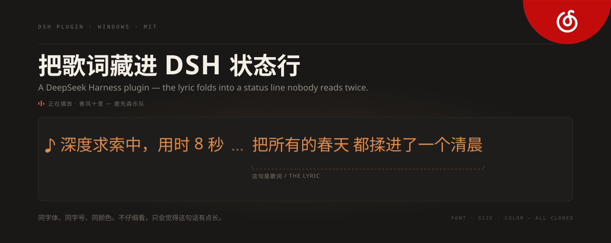
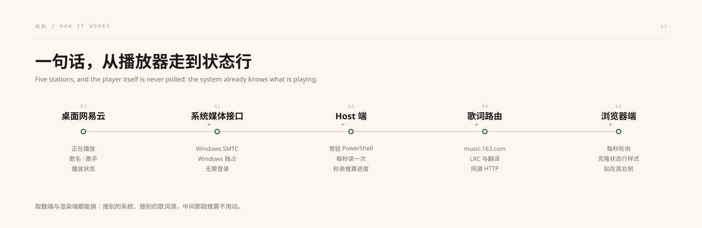
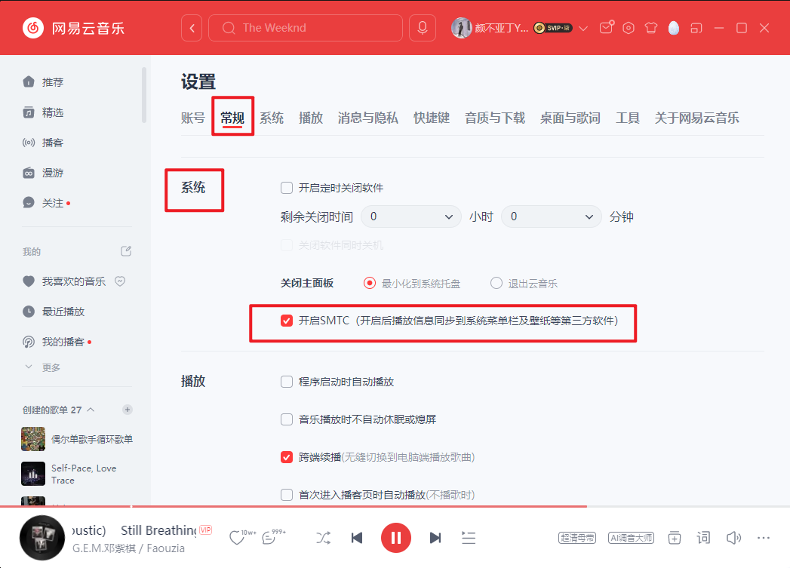

# dsh-plugin-netease-lyrics

**DeepSeek Harness（DSH）摸鱼歌词插件**：桌面网易云音乐在放什么，DSH 输入框上方的「深度求索中，用时 X 秒 …」状态行右边就同步浮现当前那句歌词——同字体、同字号、同颜色，看起来只是那句话有点长。

> 灵感：工作时要听歌，但把网易云切出来看歌词太张扬。不如让歌词藏进 DSH 自己的状态行里。

> **目前只支持 Windows 10 / 11 宿主加桌面版网易云音乐。** 其他系统与其他音乐平台的适配，欢迎一起做：有想法先到 [Discussions](https://github.com/YardonYan/dsh-plugin-netease-lyrics/discussions) 说，准备动手前看 [CONTRIBUTING.md](CONTRIBUTING.md)。

<p align="center">
  
</p>

<table>
<tr>
<td width="55%" valign="top">

## 安装

**环境要求**

- DeepSeek Harness，Windows 10 / 11 宿主
- 桌面版网易云音乐，且在 **设置 → 常规 → 系统** 勾选「**开启SMTC**」。不开的话 SMTC 读不到播放状态，这是最容易踩的坑（开关位置截图见下文"前置开关"）

**在 DSH 会话里装（推荐）**

把下面整段发给 DSH 的会话，让它替你装：

```text
帮我装一个 DSH 插件：
https://github.com/YardonYan/dsh-plugin-netease-lyrics

克隆到本地任意目录，执行：
dsh plugin --profile web add "<克隆路径>" --save-exact
装进 web profile，然后重启 dsh web、刷新页面。
装完告诉我装到哪个目录、有没有加载报错；
有报错就贴原文，不要改代码绕过。
```

**或者手动装**

```powershell
dsh plugin --profile web add "<克隆路径>/dsh-plugin-netease-lyrics" --save-exact
```

装完重启 `dsh web`（Host 端需要加载进程），刷新页面。

</td>
<td width="45%" valign="top">

## 一起共创

仓库已经开源，缺陷、适配、新功能都欢迎直接提。还没想清方案的，先到 [Discussions](https://github.com/YardonYan/dsh-plugin-netease-lyrics/discussions) 聊，定了再写代码也不迟。

最值得做的两件事：

- **适配其他系统**：把 `smtc-worker.ps1` 换成对应系统的取数方式，宿主端与浏览器端基本不用动
- **适配其他音乐平台**：`smtc-worker.ps1` 目前按 `*cloudmusic*` 过滤会话，放开匹配就能拿到别的播放器，剩下要补的是歌词源

换歌词源、修歌词匹配、调界面细节、补截图与文档同样欢迎，流程与代码约定见 [CONTRIBUTING.md](CONTRIBUTING.md)。

</td>
</tr>
</table>

## 使用

1. 打开桌面网易云放一首歌
2. 在 DSH 里随便发一条消息让 AI 转起来
3. 「深度求索中」状态行右边会出现同样式的歌词，跟着演唱进度换行
4. 鼠标悬停歌词可看完整句和翻译（如果有）；浮层不拦截点击，下方控件照常可用

## 效果预览

DSH 里的样子——歌词贴在「深度求索中」右边，一模一样的橙色小字：


此时网易云里正在放的歌（对应上面两张图）：


不仔细看，只会觉得这句状态话有点长——只有你知道那是歌词。

<p align="center">
  
</p>

## 工作原理

<p align="center">
  
</p>

```
桌面网易云音乐 ──播放──▶ Windows SMTC 系统媒体接口（歌名 / 歌手 / 播放状态）
                                   │
                                   ▼
                   插件 Host 端（DSH 宿主进程内）
                    ├─ 常驻 PowerShell worker 每秒读一次 SMTC
                    ├─ Host 秒表推算播放进度*（见"已知限制"）
                    └─ 拉取网易云歌词 API（LRC + 翻译，7 天缓存）
                                   │  同源 HTTP 路由 /plugin/netease-lyrics/*
                                   ▼
                   Client 端（浏览器 bundle）
                    └─ 每秒轮询，把当前歌词行以 fixed 定位
                       贴在「深度求索中」状态行右侧，
                       computed style 现场克隆其字体字号颜色
```

\* 网易云 PC 客户端没有通过 SMTC 上报播放位置，所以插件自己跑秒表：切歌归零、暂停停表、恢复续走。这个判断的依据与复测方法见 [docs/playback-position.md](docs/playback-position.md)。

## 当前支持范围

目前只验证了 Windows 加网易云音乐这一种组合，其他组合都还没做：

| 维度 | 已支持 | 尚未支持 |
| --- | --- | --- |
| 宿主系统 | Windows 10 / 11 | macOS、Linux |
| 音乐客户端 | 桌面版网易云音乐 | QQ 音乐、酷狗、Spotify、Apple Music 等 |

这不是改个配置就能切的事，而是实现层面的绑定：

- 播放状态来自 Windows 的系统媒体传输控件（SMTC），属于 Windows 独占接口。macOS 要另找系统级正在播放接口，Linux 走 MPRIS（D-Bus），取数方式与 Windows 完全不同
- 歌词检索走网易云的公开接口，换音乐平台就得另接歌词源，还要按对方的曲目 ID 体系重写匹配逻辑
- 播放状态与歌词源必须成对替换，只换一边跑不起来

## 必读：注意事项与已知限制

### 前置开关（不开就一定用不了）

网易云桌面版必须打开 **「开启SMTC」** 开关，否则 Windows 系统层面根本看不到网易云在放什么，插件拿不到任何数据：

> 网易云音乐 → **设置 → 常规 → 系统 → 勾选「开启SMTC」**（开启后播放信息同步到系统菜单栏及壁纸等第三方软件），勾完切一次歌生效。



这个开关也是排查「歌词不显示」的第一检查项。

| 限制 | 原因 | 缓解办法 |
| --- | --- | --- |
| **歌词不显示的第一排查项** | 网易云没开「开启SMTC」开关（设置 → 常规 → 系统） | 勾选后切一次歌生效，见上方截图 |
| 拖动网易云进度条后歌词漂移 | SMTC 不上报 seek，秒表感知不到 | 换一首歌再换回来，即重新对齐 |
| 单曲循环时秒表会走出歌尾 | 秒表不知道歌曲总长 | 同上 |
| 仅适配中文界面 | 锚点匹配「深度求索中，用时」文案 | 在插件配置里改 `anchorText`（见下） |
| AI 空闲时歌词不显示 | 设计行为：状态行不在 = 歌词隐藏（隐蔽优先） | 想常显需自行改 client.js 的 stealth 判断 |
| 仅本机访问 | 路由只响应 loopback + Origin 校验 | 这是安全特性，不开放外露 |
| 歌词取不到 | 两种原因：曲目在网易云没有版权（例如周杰伦的作品整库不在），或搜索命中的候选曲目本身没有歌词 | 无版权时插件无能为力；候选无歌词时当前只试第一条、不会继续试后面的候选 |
| **歌词长时间（小时级）空白** | 网易云公开搜索接口的 IP 限流（响应 `code: 405 操作频繁`），窗口实测可达一小时以上 | **1.0.5 起自动处理，无需操作**：插件会切换到限流计数独立的备用搜索端点，歌词最坏延迟到下一首换歌时。旧版本（≤1.0.4）遇到限流会把空结果缓存一周，请升级 |

上表里与进度有关的两条（拖动进度条后漂移、单曲循环走出歌尾）是同一个成因：网易云不通过 SMTC 上报播放位置，插件只能自己跑秒表推。这个缺口的成因、四条可选路径（系统时间轴 / UI Automation / 登录态 API / 音频指纹）与改动草案写在 [docs/playback-position.md](docs/playback-position.md)。

## 配置

在 profile 的 `cordis.patch.yml` 顶层数组里追加一条按 id 命中的补丁。不要写成 `insert`，那会新增一行插件，而不是改这一行：

```yaml
- id: netease-lyrics
  config:
    anchorText: "深度求索中，用时"   # 换成你的宿主状态行文案（英文界面等）
```

同目录下的其他插件都用这个形式，宿主按 id 找到已加载的那一行并合并 config。改完这条配置会作为第二个参数传进插件的 apply，1.0.2 起只认这条通道，不再去上下文里取。

关于 `anchorText` 的三点：

- 只认这一个键，值的用途是在页面里定位宿主状态行，不是替换歌词内容
- 未配置、配置成非字符串或空字符串时，回退到内置默认值 `深度求索中，用时`
- 客户端在加载时读取该值，改完要刷新页面；改动 `index.js` 才需要重启 `dsh web`

文案本身要选状态行里稳定出现的一小段。太短容易误匹配聊天正文，太长在状态行拆分文本节点时会匹配不到。

## 隐私与安全

- 插件不读取网易云账号、Cookie 或任何客户端数据，只读 Windows 系统媒体会话的公开快照（歌名/歌手/状态）
- 歌词经 `music.163.com` 公开接口按歌名搜索，无需登录
- HTTP 路由仅接受本机回环地址，带 Origin 校验，防 DNS rebinding

## 目录结构

```
dsh-plugin-netease-lyrics/
├── package.json          # 插件清单（dsh.bundle.patch + dsh.client）
├── cordis.patch.yml      # Loader 补丁
├── index.js              # Host 端：SMTC worker 监管 + 歌词代理路由
├── client.js             # 浏览器端：锚点定位 + 歌词渲染 + 悬停浮层
├── smtc-worker.ps1       # Windows SMTC 探测 worker（ASCII-only，PS 5.1 兼容）
├── scripts/
│   └── smtc-probe.ps1    # 单独验证 SMTC 能否读到网易云会话与时间轴
├── test/
│   └── apply-guard.test.mjs  # 客户端挂载回归测试（npm test）
├── docs/                 # 效果截图与方案文档
├── locale/               # 展示名称与描述（en / zh）
├── .github/              # Issue 与 Pull Request 模板
├── CONTRIBUTING.md       # 贡献流程、代码约定与提交规范
├── SECURITY.md           # 安全问题报告方式与关注范围
├── CHANGELOG.md          # 版本变更记录
└── icon.svg              # 插件图标
```

## 排障速查

**歌词完全不出现？**
1. 网易云在放吗？→ 放着才有效
2. 网易云「开启SMTC」开关开了吗？→ 设置 → 常规 → 系统（见"前置开关"截图）
3. AI 在转吗（「深度求索中」行存在）？→ 空闲时按设计隐藏
4. 浏览器 F12 控制台有没有 `[netease-lyrics]` 警告？→ worker 挂了会在这里提示
5. 歌在放、前面都对，还是没有？→ 去网页版网易云搜同一首歌，确认它是否被收录、有没有歌词。整库没有版权的歌手（例如周杰伦）插件取不到，这不是插件能解决的

**歌词突然卡住不走？**
网易云被暂停又恢复过、或拖动过进度条 → 切一首歌再切回来。

**颜色/位置不对？**
歌词样式是从状态行现场克隆的，若 DSH 更新改了状态行实现，重新刷新页面即可。

## 开发与贡献

环境准备、本地生效方式、代码约定与提交规范见 [CONTRIBUTING.md](CONTRIBUTING.md)。只想先跑一遍语法自检：

```powershell
npm run check
```

提缺陷时请附上系统媒体控件开关状态，以及控制台里 `[netease-lyrics]` 开头的告警原文，缺这两项多数问题无法定位。安全问题按 [SECURITY.md](SECURITY.md) 走私密报告，不要开公开 issue。

## 致谢

- [NeteaseCloudMusicApi 社区](https://github.com/Binaryify/NeteaseCloudMusicApi) 摸清的公开歌词接口参数
- [JasonCHTT/dsh-netease-music](https://github.com/JasonCHTT/dsh-netease-music) 的 README 提供了 DSH 插件挂载点参考

## 许可证

[MIT](LICENSE)
